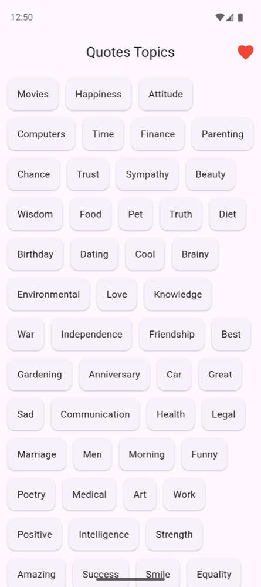
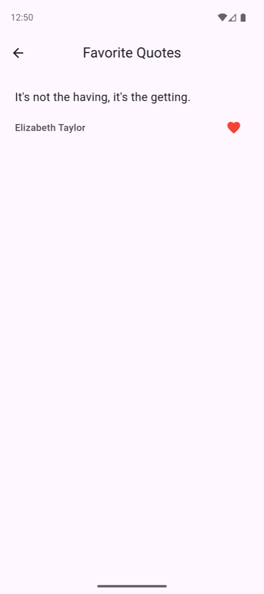
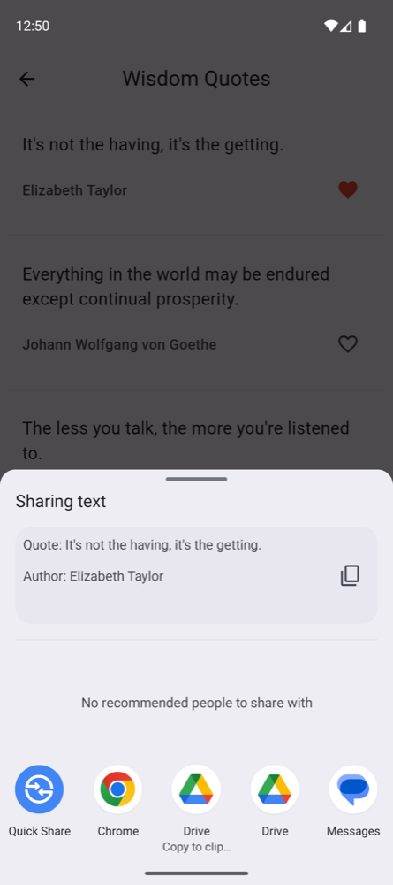

# Quotes

Browse about 44,000 quotes by topic, favorite the ones you like and share
them. Works offline after the first launch.

[Get it on Google Play](https://play.google.com/store/apps/details?id=com.zcreations.quotes)

| Topics | Favorites | Sharing |
|---|---|---|
|  |  |  |

## Features

- Pick a topic (Wisdom, Love, Success, …) to read its quotes.
- Tap the heart to keep a quote in Favorites.
- Long-press to select quotes and share them as text.
- Quotes download once and are cached in a local SQLite database, so the app
  works offline. Later launches only download when the server has new quotes.

## How it works

- `lib/engine.dart`: `Processor` (a `ChangeNotifier`) does the networking,
  the SQLite cache, selection and favorites.
- `lib/main.dart`: the topic grid and the first-launch download flow, with a
  progress snackbar and a Retry button on failure.
- `lib/screens/photos_view.dart`: the quote list for a topic or for Favorites.
- `server/`: the Flask backend (App Engine) that serves the quotes from Cloud
  Storage. It isn't deployed from this repo.

[CLAUDE.md](CLAUDE.md) has the full data flow and the platform gotchas.

## Run it

```bash
flutter pub get
flutter run
flutter test
```

Android builds need JDK 17. If Flutter picks a newer JDK that Gradle can't
run, build through Gradle with `JAVA_HOME` pointing at JDK 17.

## Releasing

Every app change pushed to `master` is a Google Play **production** release
(`.github/workflows/deploy.yml`). To release:

1. Bump `version:` in `pubspec.yaml`. The build number after `+` must increase.
2. Add a `CHANGELOG.md` entry written for users (500 characters max). It
   becomes the Play "What's new" text.
3. Merge to `master` in one push.

Pushes that only touch `server/`, docs, tests, `tool/` or CI don't release.
